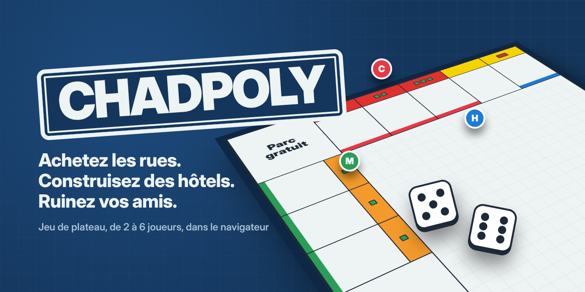
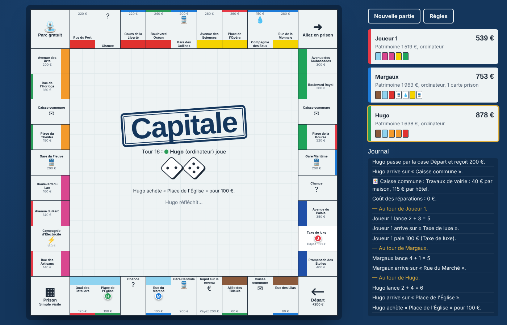

# CHADPOLY

Jeu de plateau immobilier qui se joue dans le navigateur : achetez des rues, construisez maisons et hôtels, échangez avec vos adversaires et ruinez-les. De 2 à 6 joueurs, humains (sur le même écran) ou contrôlés par l’ordinateur.

Aucune dépendance, aucune compilation : du HTML, du CSS et du JavaScript (modules ES).



## Jouer

En local, il faut un petit serveur web (les modules JavaScript ne se chargent pas en ouvrant directement `index.html`) :

```bash
npx serve .
# ou
python3 -m http.server 8000
```

Puis ouvrez <http://localhost:8000> (ou l’adresse affichée par `serve`).

### Publier en ligne avec GitHub Pages

1. Poussez le dépôt sur GitHub (voir plus bas).
2. Dans le dépôt : **Settings → Pages → Build and deployment**, source **Deploy from a branch**, branche `main`, dossier `/ (root)`.
3. Après une minute, le jeu est accessible sur <https://tom68160.github.io/monopoly/>.

## Fonctionnalités

- Plateau de 40 cases : 22 rues en 8 couleurs, 4 gares, 2 compagnies, taxes, cartes Chance et Caisse commune (32 cartes).
- Doubles, prison (double, amende ou carte), trois doubles = prison, salaire de 200 € à la case Départ.
- Loyer doublé avec une couleur complète, construction homogène, 32 maisons et 12 hôtels en banque.
- Hypothèques (levée à +10 %), revente des bâtiments à moitié prix.
- Échanges de propriétés et d’argent entre joueurs ; les bots acceptent, refusent, et vous font des offres.
- Faillite : les biens vont au créancier (ou retournent à la banque).
- Durée au choix : jusqu’à la dernière faillite, ou limite de tours (le plus gros patrimoine gagne).
- Sauvegarde automatique dans le navigateur, reprise au rechargement.
- Plateau responsive (ordinateur et mobile), raccourci clavier : <kbd>Espace</kbd> pour lancer les dés ou finir le tour.

## Structure

```
index.html        page et dialogues
css/style.css     styles
js/data.js        plateau, cartes, constantes
js/game.js        moteur de règles (sans DOM, testable)
js/bot.js         intelligence des joueurs ordinateur
js/ui.js          rendu et interactions
test/             tests du moteur (node:test)
```

## Tests

Node 18 ou plus récent :

```bash
npm test
```

Les tests couvrent les loyers, la construction, la prison, les hypothèques, les échanges, la faillite, la sauvegarde, et simulent 40 parties complètes entre bots. Ils tournent aussi automatiquement sur GitHub à chaque push (`.github/workflows/tests.yml`).

## Pousser sur GitHub

Créez un dépôt **vide** sur <https://github.com/new> (sans README ni licence), puis dans ce dossier :

```bash
git init
git add .
git commit -m "Premier commit : jeu CHADPOLY"
git branch -M main
git remote add origin https://github.com/tom68160/monopoly.git
git push -u origin main
```

## Licence

MIT. CHADPOLY est un jeu original inspiré des jeux de plateau immobiliers classiques ; il n’est affilié à aucune marque.
